

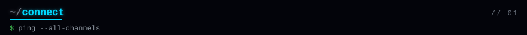

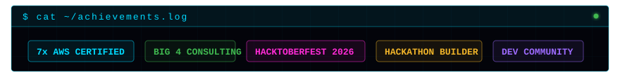
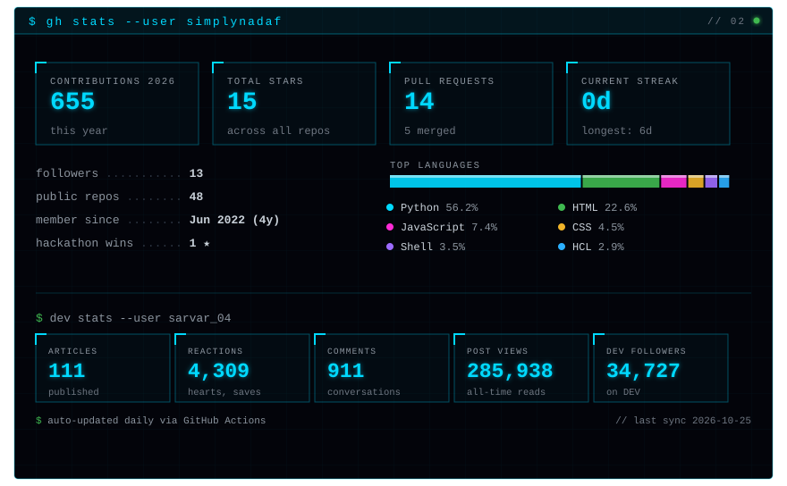
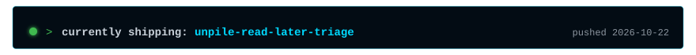
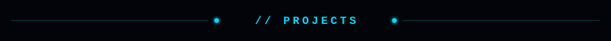
<a href="https://github.com/simplynadaf/devpub">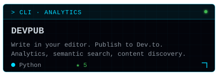</a><a href="https://github.com/simplynadaf/aws-lean-mcp">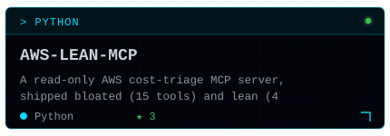</a>
<a href="https://github.com/simplynadaf/aws-auditor-agent">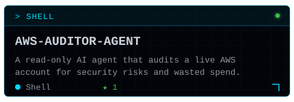</a><a href="https://github.com/simplynadaf/dog-court">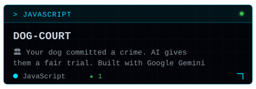</a>

<a href="https://dev.to/aws-builders/i-built-an-aws-agent-that-scores-any-github-repo-before-you-clone-it-4omp">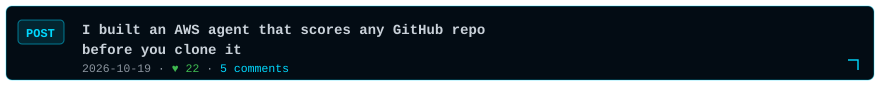</a>

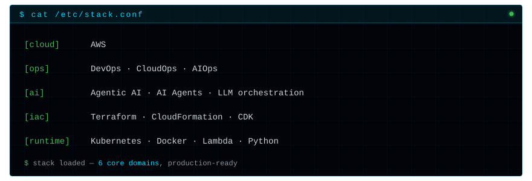

